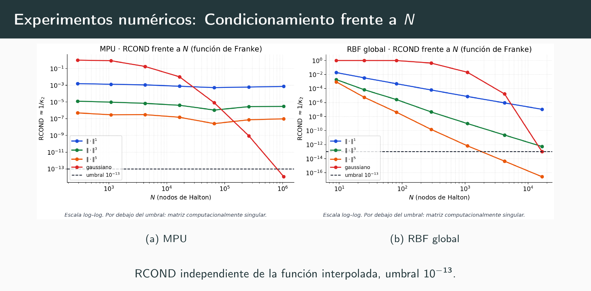
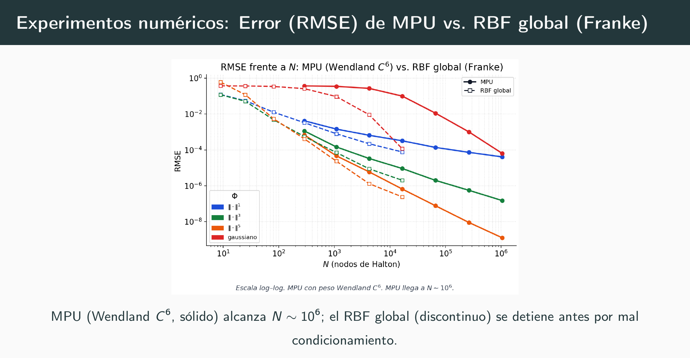
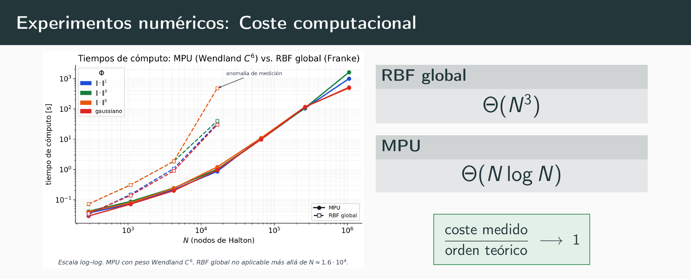

# Approximation Methods and Applications

*Bachelor's Thesis in Mathematics · Universitat de València · 2025–2026*

**[Read the thesis (PDF)](Pablo-Ramon-Muro_BSc-Thesis-Mathematics.pdf)** · **[Defence slides (PDF)](Pablo-Ramon-Muro_BSc-Thesis-Mathematics_Slides.pdf)** · both in Spanish

MATLAB code for my Bachelor's Thesis (*Trabajo de Fin de Grado*) in Mathematics at the Universitat de València.

How do you reconstruct a function from scattered data when there is no mesh to lean on? The thesis answers that in two stages. First with global radial basis function (RBF) interpolation, where a single dense linear system reproduces the data but whose condition number grows out of control as the nodes get closer. Then with partition of unity methods (MPU), which cover the domain with overlapping patches, interpolate locally on each one and glue the pieces together with smooth Shepard–Wendland weights, recovering the same approximation order at a fraction of the cost.

* **Title:** *Métodos de aproximación y aplicaciones*
* **Author:** Pablo Ramón Muro
* **Supervisor:** Dionisio F. Yáñez (Departament de Matemàtiques, Universitat de València)
* **Degree:** Double Bachelor's Degree in Physics and Mathematics, Universitat de València
* **Academic year:** 2025–2026

## Results at a glance

The three figures below are the ones shown in the defence; their labels are in Spanish. All of them use Franke's function as the target and Halton nodes as the data sites.

The reciprocal condition number $\mathrm{RCOND}=1/\kappa_2$ of the systems being solved, against the number of nodes $N$, for MPU on the left and global RBF on the right. Below the dashed line at $10^{-13}$ the matrix is computationally singular. Every global RBF kernel crosses that line at a few thousand nodes. Under MPU the $\|\cdot\|^p$ kernels stay flat, and even the Gaussian, which still degrades, only reaches the threshold around $10^6$ nodes. This is the whole reason for splitting the domain into patches.

RMS error against $N$ in log–log scale, MPU with Wendland $C^6$ weights as solid lines and global RBF as dashed ones, for the four kernels $\|\cdot\|^1$, $\|\cdot\|^3$, $\|\cdot\|^5$ and the Gaussian. The dashed curves stop where their systems stop being solvable, a little past $10^4$ nodes; MPU reaches about $10^6$ with the error still going down.

Computation time against $N$ for the same two methods. The measured cost follows $\Theta(N\log N)$ for MPU against $\Theta(N^3)$ for global RBF, and the ratio between measured time and theoretical order tends to 1, which is what `script_experimento_franke.m` prints in its last table.

## What the code does

The numerical part of the thesis compares global RBF interpolation against MPU on two test functions, Franke's function and a degree-two polynomial, and measures three things as the number of nodes grows: the RMS and maximum errors, the observed approximation order, and the reciprocal condition number of the systems being solved.

The pipeline is the same in both experiments:

1. scatter $N$ Halton nodes over the unit square and build an evaluation grid;
2. cover the domain with overlapping patches of bounded cardinality $N_j$;
3. on each patch, assemble the local interpolation system for the chosen kernel, either the Gaussian $\Phi(x)=e^{-\varepsilon^2\|x\|^2}$ or $\Phi(x)=\|x\|^p$ with $p$ odd, adding a recentred and rescaled polynomial basis where the kernel is only conditionally positive definite;
4. glue the local interpolants with Shepard–Wendland weights of class $C^2$, $C^4$ or $C^6$;
5. compare against the global RBF fit and report the errors, the order and the timings.

The two experiment scripts print their results already formatted as the LaTeX tables that appear in the thesis.

## Requirements

* MATLAB R2019b or later.
* **Statistics and Machine Learning Toolbox**, for `haltonset`, `net`, `createns`, `knnsearch` and `rangesearch`. Everything else is base MATLAB.

To run an experiment, open MATLAB, change the working directory to `code/` so that every function is on the path, and run one of the four scripts.

## Repository structure

The PDF of the thesis and the defence slides are at the root of the repository. All the code is in `code/`. It is the code listed in Appendix C of the thesis, with the comments translated into English. The `figures/` folder holds the PNG versions of the three figures shown above.

### Scripts

| File | What it does |
| --- | --- |
| `script_ejemplo_matrices_distancia.m` | First example: interpolation with distance matrices. |
| `script_rbf_gaussiano.m` | Gaussian RBF against distance matrices, including the conditioning study. |
| `script_experimento_franke.m` | Main numerical experiment, global RBF against MPU on Franke's function. |
| `script_experimento_polinomio.m` | The same experiment on the degree-two polynomial test function. |

### Building blocks

| File | What it does |
| --- | --- |
| `haltonseq.m` | Generates the Halton sequence of $N$ points in dimension $s$. |
| `MakeSDGrid.m` | Builds the equispaced grid on which the errors are evaluated. |
| `DistanceMatrix.m` | Assembles the distance matrix between data sites and centres. |
| `DistanceMatrixCSRBF.m` | Sparse distance matrix for compactly supported radial basis functions. |
| `testfunction.m` | Test function used in the first distance-matrix example. |
| `distancia_llenado_knnsearch.m` | Computes the fill distance $h_{\chi,\Omega}$ with `knnsearch`. |
| `recubrimiento_Nj.m` | Builds the patch covering with bounded cardinality $N_j$. |
| `build_poly_basis.m` | Recentred and rescaled polynomial basis for each patch. |

### Plotting

| File | What it does |
| --- | --- |
| `PlotSurf.m` | Surface plot of a two-dimensional function in 3D. |
| `PlotError2D.m` | Surface plot of the absolute error between two functions. |
| `PlotSlices.m` | Slice planes of a three-dimensional function. |
| `PlotErrorSlices.m` | Slice planes of the absolute error between two 3D functions. |

## Notes

* The code is the one listed in Appendix C of the thesis. Not a line of it has been changed; only the comments have been translated from Spanish into English, and the originals can be read in the appendix. Variable names and structure are as they were written for the experiments, which is why they are in Spanish.
* The two experiment scripts are long because they also build the result tables and time the methods; the mathematical core is in the building blocks above.

## License

The code in this repository is released under the MIT License (see [`LICENSE`](LICENSE)).

The MIT License applies to the code only. The text and the figures of the thesis and of the defence slides are © Pablo Ramón Muro, all rights reserved, and are made available here for reading and citation.

## Contact

Pablo Ramón Muro — [pramonmuro@gmail.com](mailto:pramonmuro@gmail.com) · [LinkedIn](https://linkedin.com/in/pramonmuro)

---

## Resumen (castellano)

Este repositorio contiene la memoria, la presentación de la defensa y todos los códigos de MATLAB de mi Trabajo de Fin de Grado en Matemáticas en la Universitat de València, *Métodos de aproximación y aplicaciones*, dirigido por Dionisio F. Yáñez. El trabajo estudia la aproximación sin malla: primero la interpolación con funciones de base radial globales y su problema de condicionamiento, y después los métodos de partición de la unidad, que recubren el dominio con parches solapados, interpolan localmente y pegan los trozos con pesos de Shepard–Wendland. Los códigos de `code/` son los del Apéndice C de la memoria, con los comentarios traducidos al inglés, e incluyen los dos experimentos numéricos completos sobre la función de Franke y sobre una función test polinómica.
